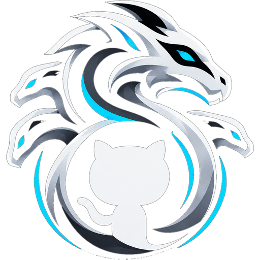
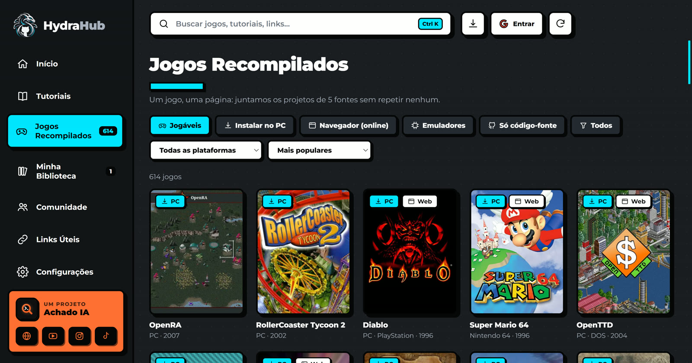
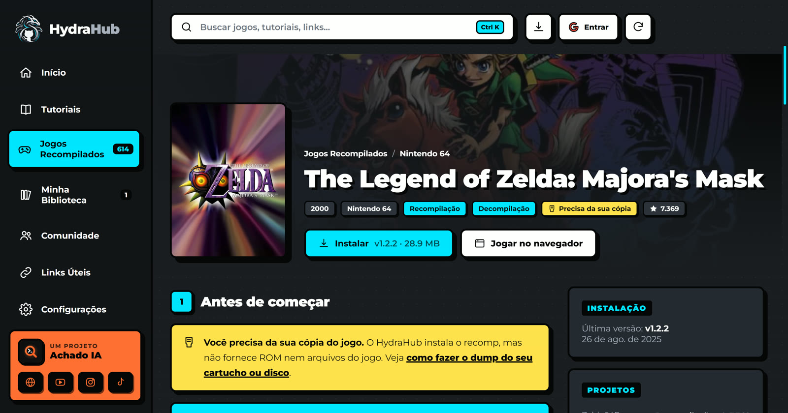
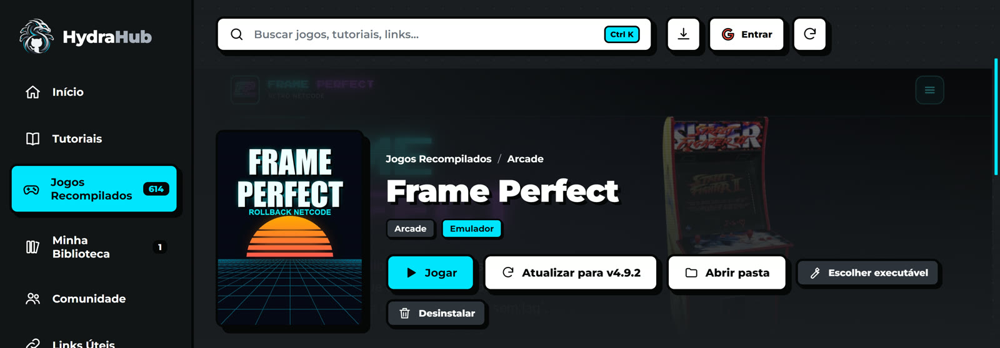
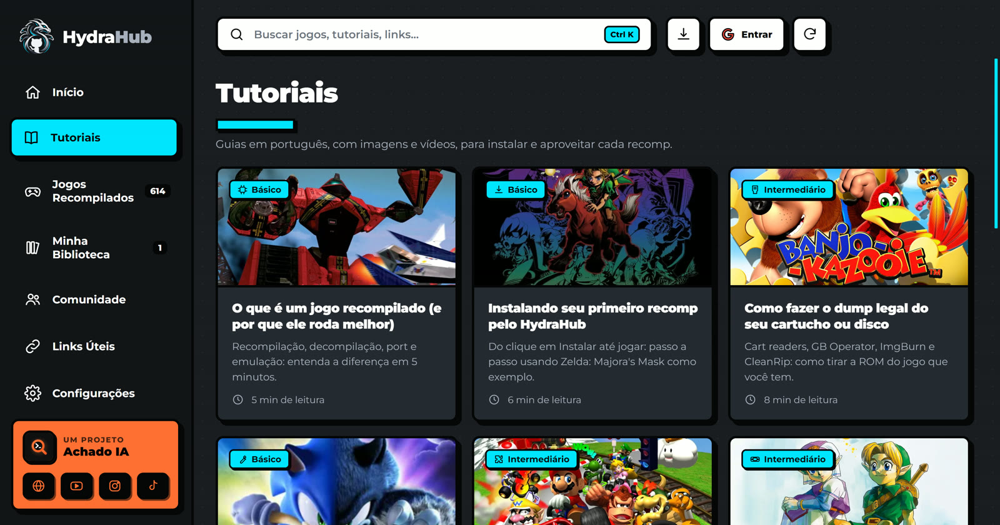

<p align="center"></p>

<h1 align="center">HydraHub</h1>
<p align="center"><b>Tutoriais · Links · Jogos recompilados</b><br>Seu hub de recomps, tudo em um só lugar.</p>

O HydraHub é um app desktop (Electron) no estilo do Hydra, feito só para **recomps, decomps e ports**: ele junta o catálogo de cinco fontes, mostra **um jogo por página** (sem repetir), com tutorial em português, imagens, vídeos e o **botão Instalar** que baixa a release oficial do GitHub, extrai e deixa pronto para jogar.

## Baixar

Pegue o **`HydraHub-Setup-x.y.z.exe`** na página de [Releases](https://github.com/achadoia/hydrahub/releases/latest) e instale. O Windows pode mostrar o aviso do SmartScreen (app sem assinatura): clique em *Mais informações → Executar assim mesmo*.

**Login com Google é opcional.** O HydraHub abre e funciona inteiro sem conta; se quiser, use o botão *Entrar* no topo ou em Configurações.

## Prints

<p align="center"></p>

| Catálogo de jogos | Página do jogo |
|---|---|
|  |  |
| **Emulador Frame Perfect** | **Tutoriais** |
|  |  |

## Fontes do catálogo

| Fonte | O que vem dela |
|---|---|
| [recomp.gg](https://recomp.gg) (API pública) | jogos, projetos, formas de jogar, passo a passo, vídeos, capas e screenshots |
| [AllRecomps](https://allrecomps.com) | projetos por console, repositório oficial, sistemas suportados |
| [Recompiled Games](https://recompiledgames.com) | ports que rodam no navegador |
| [WASM Arcade](https://wasmarcade.com) | ports de PC em WebAssembly (GTA 5, GTA III, Vice City…). Fliperama e Flash ficam de fora |
| [Frame Perfect](https://www.frameperfect.cc) | emulador arcade com rollback netcode, download direto pela API oficial |
| [SirDiabo/GithubLauncher](https://github.com/SirDiabo/GithubLauncher) | lista de recomps de N64 do launcher |

Tudo é unido por **repositório** e por **título normalizado** (sem acento, "Recompiled", numeral romano etc.), então cada jogo aparece uma vez só, com todos os projetos dentro.

O catálogo (`catalog/catalog.json`) é regenerado **todo dia** pelo GitHub Actions (`.github/workflows/catalog.yml`). O app baixa a versão nova sozinho e usa a cópia embutida se estiver offline. Os passos de instalação são traduzidos para pt-BR com Gemini quando o secret `GEMINI_API_KEY` existe (com cache em `catalog/translations.json`).

## Rodar e gerar o instalador

```bash
npm install
npm start                 # abre o app
npm run catalog           # regenera o catálogo localmente
npm run dist              # gera dist/HydraHub-Setup-x.y.z.exe (só instalador)
```

## Aviso

O HydraHub não hospeda nem baixa ROMs ou arquivos de jogos. Ele aponta para projetos open source e baixa apenas as releases publicadas pelos próprios autores. Para jogar, use o dump da sua cópia original. Nomes e marcas pertencem aos seus donos.

## Criado por

<a href="https://achadoia.com"></a> **[Achado IA](https://achadoia.com)** · [YouTube](https://www.youtube.com/@achadoia) · [Instagram](https://www.instagram.com/achadoia/) · [TikTok](https://www.tiktok.com/@achadoiaoficial)
